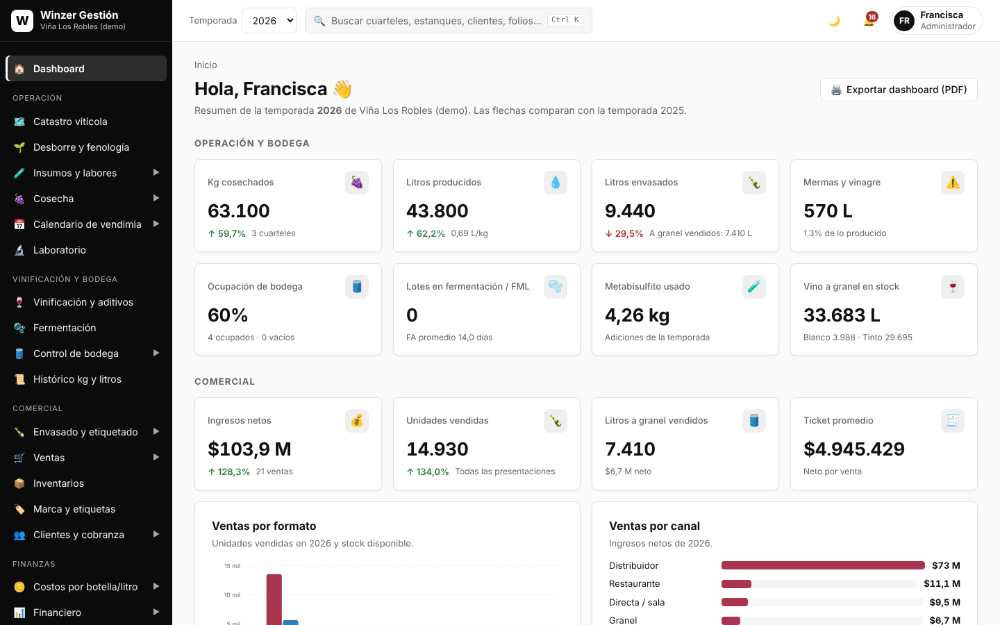
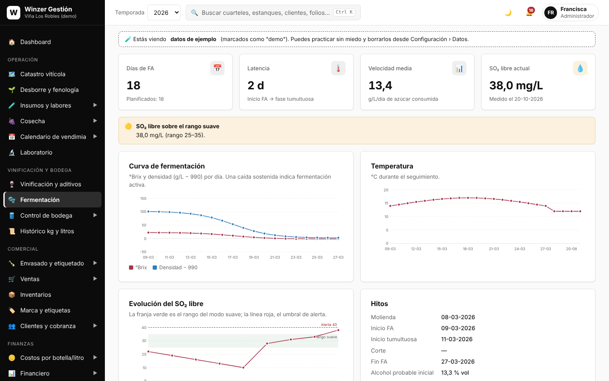
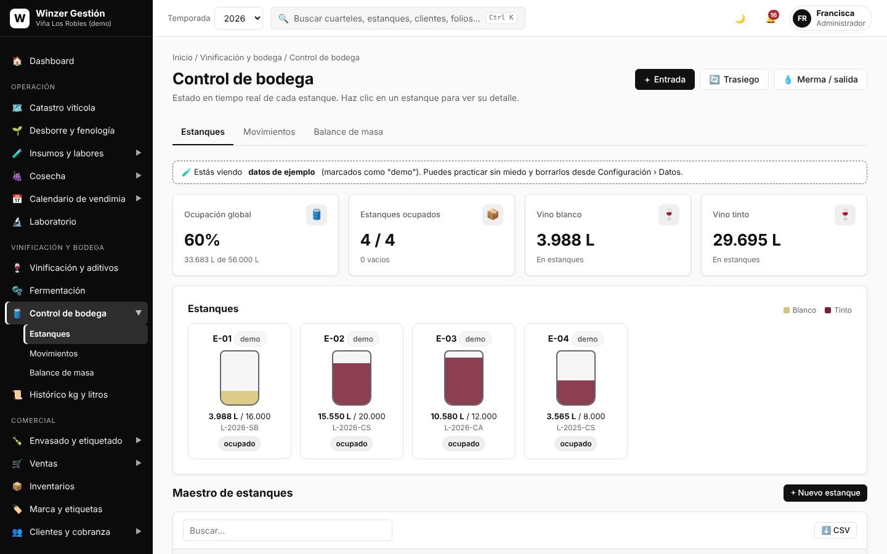
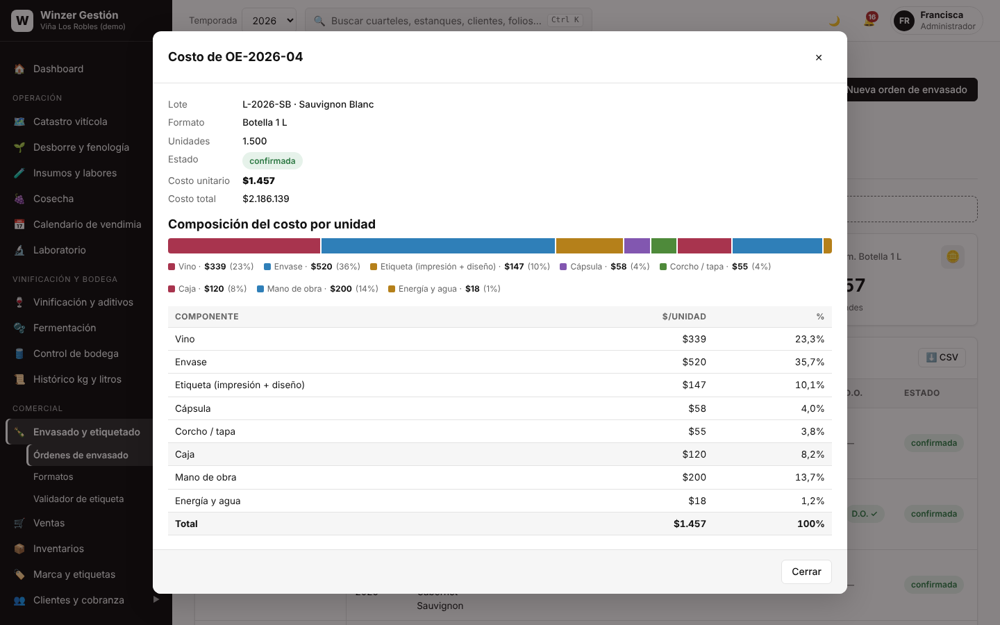
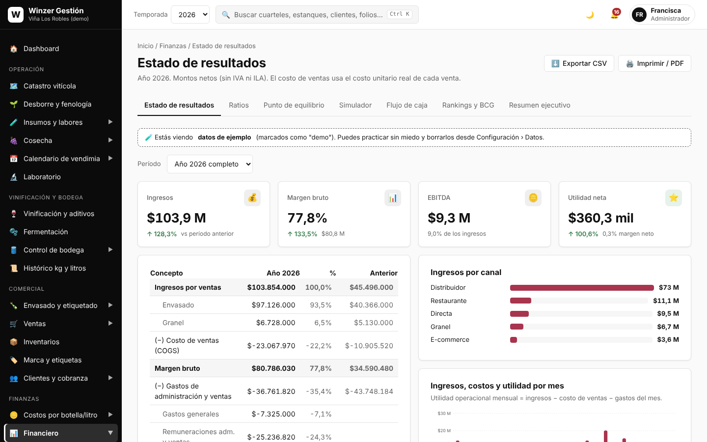
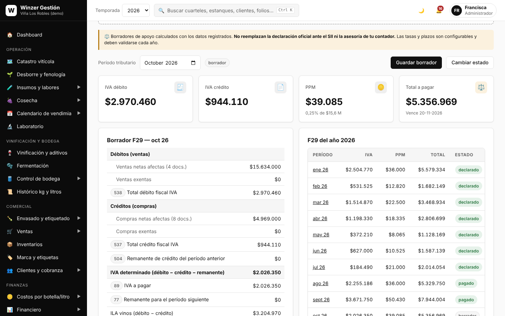
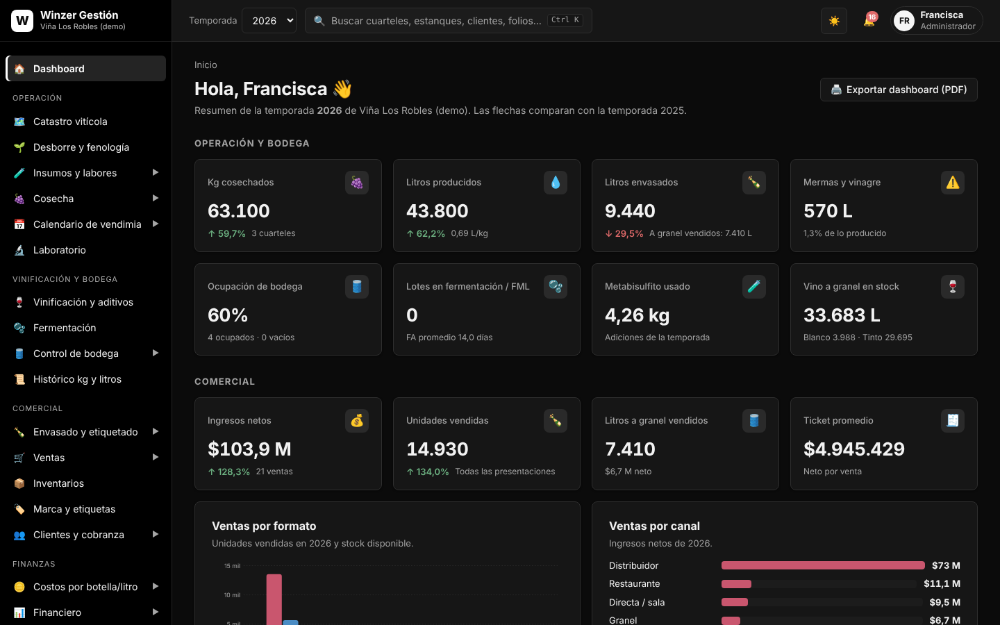
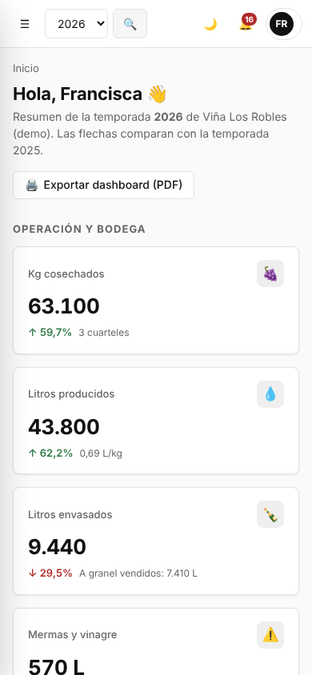

# Winzer Gestión

**Sistema de gestión integral para viñas boutique chilenas** — de la parra a la botella, y de la venta al F29.


Winzer Gestión es una aplicación web **100% frontend** (HTML + CSS + JavaScript vanilla) que cubre la cadena productiva, comercial, financiera y tributaria de una viña boutique: catastro, cosecha, fermentación con control de SO₂, bodega, envasado con costo real por botella, ventas, DTE (XML SII), conciliación bancaria, F29, PPM y Renta. Se abre con **doble clic** en `index.html`, guarda los datos en el navegador (IndexedDB) y no necesita servidor ni internet.

> 🚧 **Winzer v2 (nube, multi-viña) en desarrollo** en la rama `v2`: Next.js + Postgres con aislamiento por viña, usuarios en varias viñas con roles distintos y módulos de campo/bodega que funcionan sin señal. Ver [docs/v2/arquitectura.md](docs/v2/arquitectura.md).

> 🔗 **Demo online:** https://rootnull-sudo.github.io/winzerGES/
> En la demo, cada visitante tiene sus propios datos en su navegador; se pierden si limpia el navegador.

<p align="center"></p>

---

## Contenido

- [Requisitos](#requisitos)
- [Instalación y uso](#instalación-y-uso)
- [Funcionalidades por módulo](#funcionalidades-por-módulo)
- [Capturas](#capturas)
- [Flujo integrado](#flujo-integrado)
- [Respaldo y restauración](#respaldo-y-restauración)
- [Configuración tributaria](#configuración-tributaria)
- [Arquitectura](#arquitectura)
- [Advertencias legales](#️-advertencias-legales)
- [Cómo contribuir](#cómo-contribuir)
- [Roadmap](#roadmap)
- [Licencia y contacto](#licencia-y-contacto)

## Requisitos

- Un navegador moderno. Con doble clic en `index.html`: **Chrome o Edge**. Con el lanzador incluido: también Firefox y Safari.
- Nada más: sin Node, sin servidor, sin base de datos externa.

## Instalación y uso

1. **Descarga** el ZIP de la [última versión](../../releases/latest) o clona el repositorio:
   ```bash
   git clone https://github.com/Rootnull-sudo/winzerGES.git
   ```
2. **Abre la app** de una de estas dos formas:
   - **Chrome o Edge:** doble clic en `index.html`.
   - **Cualquier navegador (también Firefox y Safari):** doble clic en `Iniciar Winzer (Windows).bat` o, en Mac/Linux, en `Iniciar Winzer (Mac-Linux).command`. Se abre una ventana que deja la app funcionando en `http://localhost:8642`; mantenla abierta mientras la usas.

   > ⚠️ **Firefox y Safari no conservan de forma confiable los datos de páginas abiertas como archivo** (cada archivo local queda aislado). Con ellos usa siempre el lanzador. La app muestra un aviso si detecta este caso.
   >
   > Los datos se guardan por navegador y por forma de abrir: lo creado en Chrome con doble clic no aparece en Edge ni en `localhost`. Para cambiar, exporta un respaldo y restáuralo en el nuevo lugar.
3. En la primera apertura elige:
   - **Cargar datos de ejemplo** — viña ficticia con 2 temporadas de historial. Todos los usuarios demo usan el PIN `1234`.
   - **Empezar desde cero** — creas tu usuario administrador y comienzas con tus datos.
4. Cuando quieras empezar con datos reales: *Configuración › Datos y respaldos › Borrar datos demo*.

**Modo desarrollo:** abre `index.html?dev=1` para ver logs en consola y el catálogo de eventos en Ayuda. `index.html?dev=1&seed=1` carga los datos demo automáticamente en un navegador vacío.

**Atajos:** `Ctrl/⌘ + K` búsqueda global · `Esc` cerrar ventanas · `Enter` guardar formularios.

## Funcionalidades por módulo

| Área | Módulo | Qué hace |
|---|---|---|
| Operación | 1. Catastro vitícola | Cuarteles (variedad, superficie, plantación, conducción, densidad), ficha con historial y rentabilidad |
| | 2. Desborre y fenología | Inicio/50%/fin, estados BBCH, grados día (Winkler), comparación entre temporadas |
| | 3. Insumos y labores | Maestro único de insumos, aplicaciones con costo y carencia, labores de campo |
| | 4. Cosecha | Kg y cajones (validación 18–20 kg), rendimientos, cuadrillas con tarifa por kg/cajón/día, costo por kilo |
| | 5. Calendario de vendimia | Ventanas por valle (Maipo, Colchagua, Curicó, Casablanca, Leyda, Maule, Itata, Bío Bío), planificación de lotes, Gantt, desviaciones, recordatorios SAG |
| | 6. Laboratorio | Análisis por lote vs rangos objetivo, laboratorio autorizado SAG, respaldo D.O. |
| Bodega | 7. Vinificación y aditivos | SO₂, bentonita, tartárico, taninos, enzimas, levaduras; costo acumulado por litro |
| | 8. Fermentación | Seguimiento diario, metabisulfito (g → mg/L, teórico vs medido, modo suave), latencia, velocidad, FML, curvas, reporte de cierre |
| | 9. Control de bodega | Estanques en tiempo real, entradas, trasiegos, mermas, ocupación, balance de masa |
| | 10. Histórico kg y litros | Trazabilidad uva → mosto → vino → envasado/granel/vinagre/merma; CSV y JSON |
| Comercial | 11. Envasado y etiquetado | Órdenes con costo unitario desglosado, validador de etiqueta (Ley 18.455, Decreto 78), validación D.O. |
| | 12. Ventas | Granel y envasado, IVA + ILA, stock validado, DTE, anulación con nota de crédito, conciliación de litros |
| | 13. Inventarios | Producto terminado por formato y añada, granel, insumos con vencimiento, ajustes |
| | 14. Marca y etiquetas | Registro INAPI (10 años), versiones de etiqueta, amortización del diseño por botella |
| | 15. Clientes y cobranza | Maestro con RUT validado, historial, cuentas por cobrar con antigüedad |
| Finanzas | 16. Costos | Costo directo por lote, costo por formato con % de cada componente, indirectos prorrateados |
| | 17. Financiero | Estado de resultados, ratios con semáforo, punto de equilibrio, simulador, flujo de caja, BCG, resumen ejecutivo |
| | 18. Sueldos y gastos | Liquidaciones (AFP, salud, cesantía, impuesto único), honorarios, gastos clasificados, presupuesto vs real |
| | 19. Proveedores y compras | Compras que actualizan stock y precio, cuentas por pagar, evolución de precios |
| Tributario | 20. Cumplimiento normativo | SAG, patentes (Ley 19.925), INAPI, D.O., certificaciones, libro de existencias |
| | 21. DTE (SII) | Tipos 33, 34, 39, 52, 56, 61; XML con estructura SII, folios CAF, libros de compras y ventas |
| | 22. Conciliación bancaria | Importación de cartola CSV, match automático y manual, diferencias, libro de banco |
| | 23. Tributario | Borradores F29, PPM, Renta (RLI, IDPC, créditos) y calendario tributario |
| Sistema | 24. Usuarios y permisos | Roles predefinidos y personalizados, permisos por módulo, auditoría, bloqueo por inactividad |
| | 25. Dashboard | KPIs operativos, comerciales, financieros y tributarios, gráficos y alertas priorizadas |

Además: modo claro/oscuro por usuario, búsqueda global, onboarding, ayuda integrada, exportación a CSV/PDF en todos los reportes.

## Capturas

| Dashboard | Fermentación |
|---|---|
|  |  |
| **Bodega** | **Envasado (costo por botella)** |
|  |  |
| **Estado de resultados** | **F29** |
|  |  |
| **Modo oscuro** | **Móvil** |
|  |  |

## Flujo integrado

```
Cosecha → Bodega (entrada) → Fermentación → Envasado → Venta → DTE → IVA débito → F29 → Renta
Compra  → DTE recibido → IVA crédito → F29
Remuneraciones y honorarios → impuesto único y retenciones → F29
Cobros y pagos → Conciliación bancaria → Flujo de caja real
```

Los módulos no se llaman entre sí: se comunican por un **event bus** (`venta.confirmada`, `compra.registrada`, `envasado.confirmado`, …). Ver [docs/api-hooks.md](docs/api-hooks.md).

## Respaldo y restauración

Los datos viven **solo en el navegador** donde usas la app.

- *Configuración › Datos y respaldos › Exportar respaldo* descarga un JSON con todo (recomendado semanalmente).
- *Restaurar respaldo* reemplaza los datos por los del archivo.
- También puedes exportar/importar cualquier tabla en CSV (compatible con Excel en español, separador `;`).
- Para usar los mismos datos en otro computador, exporta el JSON y restáuralo allá.

## Configuración tributaria

En *Tributario › Configuración* define: régimen (14 D N°3, 14 D N°8, 14 A), tasa de primera categoría (25%/27%), tasa PPM, IVA (19%), ILA vinos (20,5%, código 25), retención de honorarios, día de vencimiento del F29 (20 con facturación electrónica), UTM, UF e ingreso mínimo. **Revisa estos valores cada año con tu contador.**

## Arquitectura

```
index.html            ← se abre con doble clic
css/                  ← tokens.css (variables de diseño), base, layout, components, modules
js/core/              ← app (arranque/layout), router (hash), store, events (bus), ui, charts, alerts, utils
js/data/              ← db (IndexedDB + respaldo localStorage), schema (entidades y migraciones), seed, backup
js/auth/              ← auth (PIN SHA-256, sesión, bloqueo), permissions (roles)
js/calc/              ← financial, tax, oenology, inventory (fórmulas documentadas)
js/integrations/      ← dte (XML SII), recon (conciliación), domain (reacciones entre módulos)
js/modules/<id>/      ← un módulo = una carpeta, cargada bajo demanda
docs/                 ← architecture.md, modules.md, api-hooks.md
```

- **Sin build:** scripts clásicos (no ES modules) para que funcione con `file://`.
- **Modular:** agregar un módulo = carpeta + manifiesto en `_registry.js`. Ver [docs/modules.md](docs/modules.md).
- **Migraciones:** cada entidad tiene versión; al detectar datos antiguos se migran solos.
- **Accesible:** navegación por teclado, `aria-*`, contraste AA, `prefers-reduced-motion`.

## ⚖️ Advertencias legales

- El sistema es una **herramienta de apoyo**. No reemplaza a un contador, asesor legal, enólogo certificado ni las declaraciones oficiales ante el **SII** o el **SAG**.
- **No envía DTE directamente al SII.** Genera el XML para que lo envíes a través de tu proveedor de certificación o servicio de facturación autorizado. La responsabilidad legal de emisión y envío es del contribuyente (Ley 19.799).
- Las tasas, regímenes tributarios, plazos y normativas cambian. **Valida con tu contador antes de declarar.**
- La autenticación es **local y básica**. No es apta para exposición en red pública o internet. Para uso multiusuario real, migra a un backend con autenticación robusta.
- **No subas datos reales al repositorio de GitHub** (clientes, RUT, precios, DTE reales). Los datos demo son ficticios. Para respaldar datos reales usa la exportación JSON fuera de GitHub (nube privada, USB).
- **GitHub Pages es solo una demo.** Cada visitante tiene sus datos locales; no hay sincronización entre dispositivos ni un backend.

## Cómo contribuir

Lee [CONTRIBUTING.md](CONTRIBUTING.md): Conventional Commits, ramas `feature/…` y `fix/…`, pruebas manuales y cómo proponer un módulo nuevo. Usa las plantillas de *Issues* para reportar errores o pedir funcionalidades.

## Roadmap

- [ ] Backend opcional (Node/Express, Supabase o Firebase) para sincronización multiusuario real
- [ ] Autenticación robusta (OAuth, JWT)
- [ ] Envío real de DTE a través de un proveedor de facturación electrónica
- [ ] Integración con APIs del SII
- [ ] Integración con proveedores de servicios agrícolas y estaciones meteorológicas
- [ ] Módulo de barricas y crianza
- [ ] Módulo de certificaciones (orgánico, biodinámico)
- [ ] E-label QR (etiqueta electrónica)
- [ ] Internacionalización (Argentina, Perú, España…)
- [ ] App móvil (PWA instalable)

## Licencia y contacto

[MIT](LICENSE) © 2026 Winzer Gestión. Contacto: abre un [issue](../../issues) o una [discusión](../../discussions).
