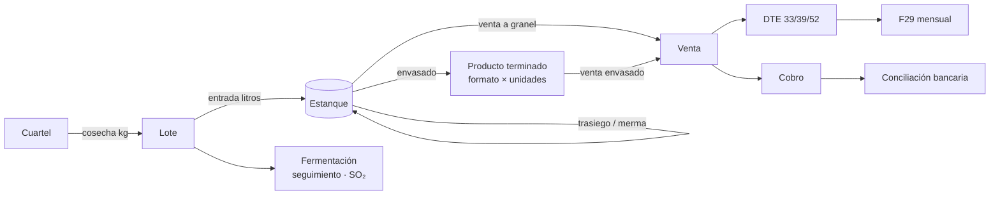

# Dominio de Winzer

Qué problema resuelve Winzer, cómo se divide y qué reglas de negocio tiene que respetar v2. Es la base de
[modelo-datos.md](modelo-datos.md) (tablas), [modulos.md](modulos.md) (pantallas y funciones) y
[hoja-de-ruta.md](hoja-de-ruta.md) (orden de trabajo).

Fuente: v1 (raíz del repo). Las referencias `archivo:línea` apuntan a v1 y sirven para portar cada regla con su test
de paridad (`loadLegacy`, ver [testing.md](testing.md)).

## El problema

Una viña boutique chilena hace el ciclo completo:

1. **Cultiva**: cuarteles, labores, aplicaciones y fenología.
2. **Cosecha**: uva por cuartel, con cuadrillas pagadas por kg, cajón o día.
3. **Vinifica**: lotes que pasan por estanques, fermentan y reciben SO₂.
4. **Envasa** en botellas y formatos.
5. **Vende**: envasado o a granel, con IVA e ILA.
6. **Compra** insumos, **paga sueldos** y **declara impuestos** (DTE, F29, PPM, renta).
7. **Cumple** con SAG, SII, INAPI y la denominación de origen (D.O.).

Hoy eso vive en planillas y cuadernos. Winzer lo junta en un registro único y trazable: del cuartel a la botella,
y de la venta al F29.

## Ciclo de vida del vino

Los costos acompañan al vino:

- **Campo**: aplicaciones y labores del cuartel.
- **Cosecha**: jornales, bins, transporte, alimentación y otros.
- **Enológicos**: aditivos y SO₂.
- **Uva comprada.**

Todo eso da el **costo por litro del lote**. Al envasar se suman los materiales, la mano de obra y la energía, y
queda el **costo por botella**, que se congela en la orden de envasado. El margen de cada venta sale de ese costo
congelado.

## Contextos

| # | Contexto | Módulos (v1) | Uso |
|---|---|---|---|
| 1 | **Núcleo** | configuración, usuarios, ayuda, dashboard | Viña, miembros, roles, temporada, parámetros, secuencias, adjuntos, alertas, tareas, auditoría, plan |
| 2 | **Viñedo** | catastro, fenologia, insumos (aplicaciones y labores), cosecha | Offline |
| 3 | **Bodega** | calendario (lotes), laboratorio, vinificacion, fermentacion, bodega, historico | Offline |
| 4 | **Inventario** | insumos (maestro), inventarios | Online, salvo la lectura de insumos que se hace offline |
| 5 | **Comercial** | envasado, ventas, marca, clientes | Online |
| 6 | **Abastecimiento y gastos** | proveedores, administracion (gastos, presupuesto), costos (activos) | Online |
| 7 | **Personas** | administracion (trabajadores, remuneraciones, honorarios) | Online |
| 8 | **Tesorería** | conciliacion | Online |
| 9 | **Tributario y cumplimiento** | dte, tributario, cumplimiento | Online |
| — | **Análisis** (solo lectura) | costos, financiero, dashboard | Online; lee todo lo demás |

Un módulo es dueño de sus tablas: es el único que las escribe. Otro módulo puede escribirlas solo a través de un
**servicio** o una **reacción** (ver [adr/0010](adr/0010-documentos-y-libros.md)).

## Glosario

| Término | Significado |
|---|---|
| **Viña** | Cliente de la plataforma (tenant). Todos sus datos llevan `org_id` |
| **Temporada** | Año de vendimia. La temporada 2026 va de julio de 2025 a junio de 2026: el desborre de septiembre ya cuenta para la vendimia siguiente |
| **Cuartel** | Bloque de viñedo con una variedad, superficie (ha), año de plantación, densidad y conducción |
| **Fenología** | Etapas de la vid en la temporada: desborre (inicio, 50%, fin), floración, envero. Escala BBCH |
| **Grados día** | Σ max(0, (Tmáx + Tmín)/2 − Tbase), con Tbase = 10 °C. Índice Winkler: < 1.390 Región I … ≥ 2.220 Región V |
| **Carencia** | Días que deben pasar entre una aplicación fitosanitaria y la cosecha |
| **Lote** | Unidad de vino que se sigue de la vendimia a la venta. Viene de uno o más cuarteles |
| **Estanque** | Recipiente de bodega con capacidad en litros. Puede tener uno o más lotes |
| **Trasiego** | Paso de vino de un estanque a otro, con posible merma |
| **FA / FML** | Fermentación alcohólica / maloláctica. La FML solo aplica a tintos |
| **SO₂ libre/total** | Sulfuroso en mg/L. Se agrega como metabisulfito de potasio (57% SO₂) o de sodio (67%) |
| **Formato** | Presentación de venta: 750 ml, 375 ml, magnum, bag-in-box… |
| **Orden de envasado** | Transforma litros de un estanque en unidades de un formato, consumiendo insumos |
| **D.O.** | Denominación de origen. Para declararla se exige ≥ 75% de uva de la zona y un certificado |
| **RUT** | Identificador tributario chileno con dígito verificador módulo 11 |
| **DTE** | Documento tributario electrónico. Tipos: 33 factura, 34 factura exenta, 39 boleta, 52 guía de despacho, 56 nota de débito, 61 nota de crédito |
| **CAF** | Rango de folios autorizado por el SII para un tipo de DTE |
| **IVA** | 19% sobre el neto |
| **ILA** | Impuesto adicional a bebidas alcohólicas (20,5% para vinos; ver la nota en Comercial) |
| **F29** | Declaración mensual: IVA débito − crédito, PPM, ILA, retenciones e impuesto único |
| **PPM** | Pago provisional mensual a cuenta de la renta anual: % sobre las ventas |
| **Remanente** | Crédito de IVA que sobra y pasa al mes siguiente |
| **UF / UTM / IMM** | Unidad de fomento / unidad tributaria mensual / ingreso mínimo mensual. Cambian en el tiempo |
| **Liquidación** | Cálculo de sueldo: imponible, AFP, salud, AFC, impuesto único, líquido y costo empresa |
| **Cartola** | Extracto bancario. Se importa en CSV |

## Reglas de negocio por contexto

Cada regla dice dónde está en v1 y si ya está portada a `packages/domain`.

### Viñedo

- **Cuartel**
  - El código es único por viña sin distinguir mayúsculas.
  - Si no se ingresan las plantas: plantas = superficie × densidad.
  - Ya portado en `entities/catastro.ts`.
- **Kg esperados** = superficie × rendimiento esperado. v1 usa 8.000 kg/ha y 19 kg/cajón fijos en el código
  (`catastro/index.js:24`); en v2 pasan a ser parámetros.
- **Fenología**
  - Fechas en orden: inicio ≤ 50% ≤ fin.
  - Alertas: variación de 7 días o más frente a la temporada anterior; desborre sin fin después de 25 días.
- **Clima**: Tmín ≤ Tmáx. Grados día y Winkler con `oenology.gradosDia` (ya portado).
- **Aplicación**
  - Cantidad sugerida = dosis/ha × superficie.
  - Costo = cantidad × precio del insumo.
  - "Cosechar desde" = fecha + carencia.
  - Descuenta stock del insumo (`mov_insumo`).
  - Alerta si se cosecha dentro de la carencia.
- **Labor**: costo = jornadas × valor de la jornada + otros.
- **Cosecha**
  - kg/cajón ∈ [kgCajonMin, kgCajonMax] (`oenology.cajonValido`).
  - Costo = Σ pago de jornales + bins + transporte + alimentación + otros.
  - Costo/kg = costo ÷ kg.
- **Jornal**: pago = tarifa × (kg | cajones | jornadas), según el tipo de tarifa (`financial.js:63`).

### Bodega

- **Lote**
  - Máquina de estados: Planificado → En vendimia → En molienda → Fermentando → (Macerando) → FML → En guarda →
    Envasado → Finalizado.
  - Los cambios los provocan las reacciones (ver la tabla de reacciones).
- **Plan de vendimia** (`calendario/index.js:28-42`):
  - Molienda = vendimia + 1.
  - Inicio FA = molienda + 1.
  - Fin FA = inicio + díasFA (10 en tintos, 18 en blancos).
  - Descube = máx(fin de maceración, fin FA).
  - FML desde descube + 2.
  - Guarda = fin FML (o descube) + 90.
  - Desviación = real − plan. Alerta si supera ±`desviacionDias`.
- **Ventanas de vendimia**: por variedad × valle, en formato mm-dd. Fecha fuera de la ventana → aviso.
- **Estanque**
  - Stock = Σ `mov_bodega.litros`.
  - Ocupado si tiene más de 0,5 L.
  - No admite entradas en mantención ni por sobre su capacidad (`inventory.validarEntrada`).
- **Trasiego**: salida (litros + merma) ≤ litros del lote en el estanque de origen. Escribe 2 o 3 movimientos con el
  mismo `grupo`.
- **Balance de masa por lote**: entradas = stock + envasado + granel vendido + mermas + vinagre ± ajustes. En v1 la
  fórmula es tautológica (ver bugs). En v2 se compara contra los **kg de uva × rendimiento esperado**, que es lo que
  sirve para detectar pérdidas.
- **Fermentación**
  - °Brix desde la densidad = 261,3 × (1 − 1000/densidad).
  - Alcohol probable = °Brix × 10 / 16,83.
  - Días FA, latencia, velocidad y desvío con `oenology.tiempos`.
  - Todo eso ya está portado en `oenology.ts`.
- **SO₂**
  - Dosis mg/L = g × 1000 × fracción / L.
  - Gramos para una dosis = mg/L × L / (1000 × fracción).
  - Estado: crítico si supera la alerta, alto si supera el máximo, bajo si está bajo el mínimo, si no ok. Los
    rangos son por tipo de vino y van en `parametro_org`.
  - Si no pasó el intervalo mínimo desde la última adición (24 h) → hay que confirmar.
  - Eficiencia = (medido − previo) / dosis.
- **Aditivos**
  - Cantidad = dosis g/hL × L / 100, convertida a la unidad del insumo **con conversión explícita** (ver bugs).
  - Costo = cantidad × precio.
- **Laboratorio**: rangos objetivo por tipo de vino (pH, acidez total y volátil, SO₂, alcohol, azúcar residual). En v2
  pasan a ser parámetros. El límite legal de acidez volátil, 1,5 g/L, también se alerta.

### Inventario

- **Stock de insumo** = stock inicial + Σ `mov_insumo.cantidad`.
  - Alertas: stock bajo el mínimo; vencimiento en 30 días o menos.
  - Valorización al precio vigente.
- **Precio del insumo**: cada compra actualiza el precio y agrega una entrada al historial de precios.
- **Producto terminado**: en v1 se calcula como unidades de la orden − ventas. En v2 pasa a un libro
  `mov_producto` (+ al envasar, − al vender, ± por ajuste) para poder registrar quiebres, muestras y conteos.

### Comercial

- **Orden de envasado**
  - Unidades × litros del formato × (1 + merma) ≤ litros disponibles en el estanque.
  - Si declara D.O.: % de uva de la zona ≥ 75 y certificado.
  - Al confirmar se congela `costoUnitario` (`financial.costoEnvasado`):
    - litros × (1 + merma) × costo/L del lote;
    - envase, etiqueta (impresión + diseño prorrateado), cápsula y cierre;
    - caja ÷ unidades por caja;
    - (mano de obra + energía) ÷ unidades.
  - Confirmada = bloqueada.
- **Validador de etiqueta** (Ley 18.455, Decreto 78): denominación, % vol, contenido, envasador, domicilio, país,
  N° SAG, ≥ 75% para varietal y añada, advertencia de sulfitos.
- **Venta**
  - Totales: IVA = round(neto × 0,19); ILA = round(neto × tasaILA) si aplica; total = neto + IVA + ILA + exento
    (`tax.totales`, ya portado).
  - Valida stock.
  - Congela el costo unitario de cada línea para calcular el costo de ventas.
  - Con DTE emitido no se pueden cambiar cantidad ni precio.
  - Anular con DTE: genera la nota de crédito 61 (o anula la boleta).
- **ILA por graduación**: v1 usa una tasa fija y nunca usa la graduación. **Decisión pendiente** antes de portar:
  confirmar con el contador si la viña tributa ILA y con qué tasa (en Chile la tasa del vino no depende de los
  grados, pero la ley los distingue frente a otras bebidas). Mientras tanto, tasa configurable por viña.
- **Cliente**: RUT válido. No se borra si tiene ventas. Ya portado.
- **Cobranza**
  - Saldo = total − Σ cobros aplicados.
  - Antigüedad: por vencer / 1–30 / 31–60 / > 60 días.
  - Cobros parciales permitidos.

### Abastecimiento y gastos

- **Compra**
  - Folio único por proveedor + tipo de documento.
  - IVA solo en factura.
  - La nota de crédito se guarda con montos **positivos** y tipo 61; el signo lo pone el libro. Esto corrige un bug
    de v1.
  - Suma stock del insumo (o lo resta si es nota de crédito) y registra el DTE recibido.
- **Pago a proveedor**: parcial o total, aplicado a compras. Saldo = total − Σ pagos aplicados.
- **Gasto**: 12 categorías, fijo/variable, área. Si es factura afecta, genera un DTE recibido para el crédito de IVA.
- **Presupuesto**: por año y categoría. Proyección = real ÷ meses transcurridos × 12.
- **Activo fijo**
  - Depreciación lineal = valor ÷ vida útil, **solo dentro de la vida útil** y prorrateada desde la fecha de compra.
    Esto corrige un bug de v1.
  - Marca: amortización a 10 años desde su registro.

### Personas

- **Liquidación** (`tax.liquidacion`, ya portada):
  - Gratificación art. 50 = mín(25% × base, 4,75 × IMM ÷ 12).
  - Imponible = base + gratificación + bonos + comisiones + horas extra.
  - Tope = 87,8 UF (debe ser un indicador, no un valor fijo).
  - AFP sobre el imponible con tope.
  - Salud = máx(7%, plan Isapre).
  - AFC trabajador 0,6% (0 si el contrato es a plazo fijo), con su propio tope en UF (falta en v1).
  - Impuesto único por tramos en UTM.
  - Líquido.
  - Costo empresa = AFC empleador (2,4% o 3%) + SIS + aporte del empleador.
- **Parámetros**: usa UF, UTM e IMM **del mes de la liquidación** (indicadores con vigencia) y guarda la foto de lo
  usado.
- **Honorarios**: retención = round(bruto × 15,25%). La tasa cambia por año, así que va como indicador.

### Tesorería

- **Importar cartola**: CSV con columnas configurables, varios formatos de fecha, sin duplicados (fecha + monto +
  glosa).
- **Candidatos del libro**: cobros (no ventas completas), pagos a proveedores, sueldos pagados (líquido), gastos
  pagados, impuestos pagados y honorarios pagados (líquido).
- **Conciliación**: mismo monto ±1 peso y fecha ±7 días. Puntaje = 1 − días ÷ 8. Se aplica sola si hay un único
  candidato o si el mejor supera claramente al resto.
- **Resumen por cuenta**: el bug de v1 es que no filtraba por cuenta.

### Tributario y cumplimiento

- **Folios**: el siguiente folio libre del CAF vigente, **sin reutilizar** (secuencia + CAF). Aviso al usar el 80%.
- **Libros**: el signo lo da el tipo (61 = −1; 52 no entra al libro).
- **F29** (`tax.f29`, ya portado):
  - Débito − crédito − remanente anterior.
  - PPM = (neto + exento) × tasa.
  - ILA ventas − ILA compras.
  - Más retención de honorarios e impuesto único.
  - Estados: borrador → revisado → declarado → pagado.
  - Al pagarlo se registran los pagos de impuesto y se cumple la obligación del calendario.
- **Remanente**: recursivo desde el último F29 declarado (`tax.js:152`). Por portar.
- **Renta**:
  - RLI = máx(0, UAI + gastos no deducibles).
  - IDPC = RLI × tasa según régimen (14D3 25%, 14A 27%).
  - Resultado = IDPC − PPM pagados.
  - Por portar.
- **Calendario**:
  - 12 F29;
  - renta (30 de abril);
  - patentes (31 de enero y 31 de julio);
  - 4 cuotas de contribuciones;
  - SAG (declaración de cosecha del 1 al 30 de junio, de existencias del 1 al 19 de enero).
- **Cumplimiento**
  - Registro con vencimiento y aviso N días antes.
  - Controles automáticos: lotes sin análisis de un laboratorio autorizado por el SAG, y D.O. sin respaldo.
  - Exporta el libro de existencias.
- **DTE**: en esta etapa se **simula**, como en v1: XML sin firma ni TED y estados manuales. El envío real al SII
  queda detrás de una interfaz `ProveedorDTE` (ver [modelo-datos.md](modelo-datos.md)).

### Análisis (solo lectura)

- **Costo por litro del lote** (`financial.costoLitroLote`):
  - costo de cosecha;
  - + costo de campo del cuartel × kg del lote ÷ kg del cuartel en la temporada;
  - + aditivos + SO₂;
  - + uva comprada;
  - todo ÷ litros de entrada.
- **Estado de resultados**:
  - Ingresos − costo de ventas = margen bruto.
  - − gastos de administración y ventas, − indirectos = EBITDA.
  - − depreciación − amortización = EBIT.
  - − gastos financieros = UAI.
  - − impuesto = utilidad neta.
- **Ratios, punto de equilibrio, simulador, rankings (BCG) y resumen ejecutivo**: `financial.js:204-345`.
- **Flujo de caja** mensual: entradas por cobros; salidas por pagos, **líquido** de sueldos, honorarios líquidos,
  gastos y F29. Esto corrige la doble contabilización de v1.
- **Dashboard**: KPIs por área con comparación contra la temporada anterior, **todos con el mismo criterio de
  temporada**.

## Reacciones entre módulos

v1 las hace con eventos en el navegador (`js/integrations/domain.js`). En v2 ocurren **en el servidor y en la misma
transacción**, como servicio (acción online) o como reacción de sync (entidad offline).

| Disparador | Efecto | En v2 |
|---|---|---|
| Entrada de bodega (`mov_bodega` tipo entrada) | Crea la ficha de fermentación en borrador si el origen no es vino; lote → En molienda | Reacción de sync `mov_bodega` |
| Cosecha creada | Lote Planificado → En vendimia | Reacción de sync `cosecha` |
| Inicio de FA | Lote → Fermentando | Reacción de sync `fermentacion` |
| Fin de FA | Lote → FML (tinto) o En guarda; tarea de trasiego para el enólogo | Reacción de sync `fermentacion` |
| Aplicación / aditivo / adición de SO₂ | `mov_insumo` negativo | Reacción de sync de cada una |
| Confirmar envasado | `mov_bodega` −L, `mov_insumo` de materiales, `mov_producto` +unidades, lote → Envasado si queda < 1 L | Servicio `confirmarEnvasado` |
| Confirmar venta | `mov_producto` −unidades o `mov_bodega` −L granel; DTE si corresponde | Servicio `confirmarVenta` |
| Anular venta | Revierte movimientos; NC 61 o anula la boleta | Servicio `anularVenta` |
| Registrar compra | `mov_insumo` +, precio e historial, DTE recibido | Servicio `registrarCompra` |
| Gasto con factura afecta | DTE recibido | Servicio `registrarGasto` |
| F29 pagado | Pagos de impuesto + obligación cumplida | Servicio `pagarF29` |
| Diferencia bancaria | Gasto financiero conciliado | Servicio `registrarDiferencia` |

## Alertas

v1 recalcula todo en cada lectura (`js/core/alerts.js`). En v2, un **job** por viña las calcula y las guarda en
`alerta` (ver [adr/0012](adr/0012-jobs-y-alertas.md)). Reglas:

- **Bodega**: SO₂ fuera de rango; desvío de la FA; FML de más de 45 días; seguimiento atrasado (más de 2 días);
  estanque sobre su capacidad; mermas sobre el 3%.
- **Viñedo**: cosecha dentro de la carencia; carencia que vence en 21 días o menos; cajones fuera de rango;
  desborre sin registrar desde el 15 de octubre.
- **Inventario**: stock bajo el mínimo; insumo que vence en 30 días o menos; formato bajo el mínimo.
- **Normativo**: D.O. sin respaldo; cumplimiento o marca por vencer; vencimientos del calendario tributario.
- **DTE**: DTE rechazado; folios sobre el 80%.
- **Tesorería**: movimientos bancarios sin conciliar.
- **Finanzas**: cuentas por cobrar o pagar vencidas; margen bajo el mínimo; ventas bajo el punto de equilibrio; flujo
  de caja negativo.
- **Tareas**: tareas pendientes del usuario o de su rol.

## Bugs de v1 que v2 corrige

1. **Nota de crédito de compra con doble negativo** (`proveedores/index.js:35` + `tax.js:112`): sube el crédito de IVA
   y el stock. → Montos positivos; el signo lo pone el tipo.
2. **Flujo de caja**: el costo empresa de los sueldos ya incluye el impuesto único y las cotizaciones, y el F29 vuelve
   a sumarlos; con los honorarios pasa lo mismo (`financial.js:292-295`). → Líquido + F29.
3. **Cobros y pagos parciales**: "marcar pagada" ignora los anteriores y la conciliación solo ve la venta completa;
   la entidad `pago` no se usa (`ventas:114`, `recon.js:43`). → Aplicaciones a documentos.
4. **Depreciación sin fin y amortización de marca sin fechas** (`financial.js:145-156`). → La depreciación se
   prorratea por día y termina con la vida útil o la baja (F3-5); la marca, en F5-1.
5. **Resumen bancario sin filtro por cuenta** (`recon.js:89`).
6. **Códigos y folios reutilizados** (count + 1 y relleno de huecos). → Secuencias.
7. **Balance de masa tautológico** (`inventory.js:111-119`): siempre cuadra. → Comparar contra los kg de uva.
8. **ILA sin regla clara**: decidir antes de portar (ver Comercial).
9. **Valores fijos en el código**: 8.000 kg/ha, 19 kg/cajón, 1,5% de merma, 87,8 UF, tramos del impuesto único,
   rangos de laboratorio, año 2026 en las ventanas. → Parámetros o indicadores.
10. **Unidades**: el SO₂ y los aditivos asumen kg (`vinificacion/index.js:14-18`, `fermentacion/index.js:187`). →
    Conversión explícita según la unidad del insumo.
11. **Dashboard**: mezcla filtros por temporada y por año calendario.
12. **XML de DTE**: declara ISO-8859-1 pero se genera en UTF-8 (`dte.js:114`).
13. **Temperatura de fermentación**: la ayuda dice "aviso" pero bloquea el guardado.

Corregidos al migrar el viñedo (F1):

14. **Borrados que dejan huérfanos**: el borrado masivo no llamaba `afterRemove`, así que quedaban consumos de
    aplicaciones (y el stock bajo) y jornales sin cosecha. → Reacciones de sync idempotentes.
15. **Consumos duplicados**: el seed escribía consumos sin id de aplicación y editar sumaba otro. → Id derivado de
    la aplicación.
16. **Costo de la labor desactualizado**: solo se calculaba si estaba vacío. → Siempre jornadas × valor + otros.
17. **Grados día de todo el año**: la pantalla decía "desde el 1 de septiembre" y sumaba todo. → 1 sep – 30 abr.
18. **Desborre faltante dibujado como 0** en el gráfico. → Se omite.
19. **Historial de precios sin el precio inicial** y nunca visible. → `insumo_precio` con el inicial, en el diálogo.
20. **Jornal por día sin jornadas pagaba 1 día**. → Es obligatorio.
21. **Alertas de carencia de todas las temporadas** y umbral de vencimiento fijo en la lista. → Temporada actual y
    el parámetro de la viña.

22. **Ajustes de bodega sin validar** capacidad ni stock, y **borrar movimientos sin revalidar**. → Validación en el
    servidor (reacción) para todo movimiento, incluidos ajustes y borrados.
23. **Trasiego a medias**: si la entrada fallaba, la salida quedaba. → Grupo atómico.
24. **Ocupación por tipo**: un estanque con dos lotes se atribuía entero al principal. → Se reparte por lote.
25. **Fin de FA retrocedía el lote** (de Envasado a En guarda) y **creaba una tarea en cada guardado**. → Nunca hacia
    atrás; tarea con id derivado.
26. **SO₂ descontado siempre en kg** y **medición huérfana al borrar la adición**. → Unidad real del insumo; la reacción
    borra ambos.
27. **°Brix 0 ignorado** en los tiempos de fermentación. → Cuenta como dato.
28. **Dos caminos para el SO₂** (aditivo tipo SO₂ y adición en la ficha) que descontaban el insumo por separado. → Solo
    la ficha; el importador omite los aditivos de SO₂ de v1.
29. **Aditivos en kg fijos** aunque el insumo fuera líquido o en gramos. → Dosis en g/hL o mL/hL y cantidad
    convertida a la unidad del insumo (el servidor la recalcula).
30. **Rangos de laboratorio fijos** y el de SO₂ libre duplicado con el de fermentación. → Parámetros de la viña
    (`enologia.labBlanco/labTinto`); el SO₂ libre sale de `enologia.so2Blanco/so2Tinto`.
31. **Gráfico de laboratorio con "acidez × 5"** en el eje del SO₂. → Un gráfico por parámetro, con su franja objetivo.
32. **Histórico: kg y litros en un mismo eje** y variación contra una temporada vacía. → Gráficos separados (kg con
    L/kg; litros por tipo) y la variación compara con la última temporada con litros.
33. **Desvío de FA en curso**: v1 comparaba los días transcurridos con el plan y avisaba "−8 días" apenas partía.
    → En curso solo avisa si ya superó el plan; terminada, en ambos sentidos.
34. **Mermas altas para siempre**: v1 avisaba también de lotes ya vendidos o envasados. → Solo lotes con stock.
35. **Plazo 0 del proveedor = 30 días** (`plazo || 30`). → 0 es contado: vence el mismo día.
36. **Editar una compra antigua retrocedía el precio del insumo** y anularla no lo revertía. → Precio vigente = el
    del historial con la fecha más reciente; anular recalcula.
37. **Guía y factura contaban dos veces** como deuda (y el stock, si ambas tenían insumo). → La guía mueve stock sin
    deuda; la factura que la referencia no vuelve a mover stock.
38. **IVA fantasma en gastos**: `afectoIVA` quedaba en true (oculto) en boletas y "otro", y el flujo y la
    conciliación sumaban un 19 % no pagado. → Solo en factura; IVA y total se guardan con la tasa de la fecha.
39. **Presupuesto**: no se podía presupuestar una categoría sin gastos y los meses salían del reloj del navegador.
    → Todas las categorías editables; meses desde la fecha de evaluación.
40. **Liquidación**: tope imponible fijo (87,8 × UF con un respaldo 39.500 distinto del valor por defecto), el seguro
    de cesantía usaba el tope de AFP, el contrato por obra cotizaba como indefinido, la gratificación "ninguna"
    pagaba un monto viejo, el plan Isapre seguía contando con Fonasa y no había días, horas extra ni anticipos. →
    Topes como indicadores, tope propio del seguro de cesantía, obra = plazo fijo, todo lo demás en `liquidacion`.
41. **Sueldo bajo el IMM bloqueaba el guardado** (jornada parcial imposible). → Aviso.
