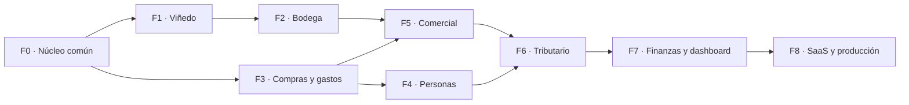

# Hoja de ruta

Orden de trabajo para llevar v2 a la paridad con v1 y luego al servicio multi-viña completo. Qué hace cada módulo:
[modulos.md](modulos.md). Tablas: [modelo-datos.md](modelo-datos.md). Cómo trabajar en paralelo:
[colaboracion.md](colaboracion.md).

## Fases y carriles

- **F0 bloquea todo.** Conviene que lo haga una sola persona en PRs chicos, mientras la otra prepara las pantallas
  de F1 o F3 con datos de prueba.
- **Carril A** (campo y bodega, offline): F1 → F2. **Carril B** (negocio, online): F3 → F4.
- **F5 (Comercial)** junta los dos carriles: envasado necesita bodega y compras necesita insumos.
- Desde F6 se puede volver a repartir por módulo.

## Reglas de reparto

1. Cada issue nombra **sus tablas**. Solo ese PR las crea, en un bloque propio al final de `schema.ts`.
2. Si un issue necesita una tabla de otro que todavía no existe, se espera o se acuerda en el issue quién la crea.
   Nunca la crean los dos.
3. Los servicios compartidos (`packages/db/src/services/`) y las reacciones de sync son **código compartido**: van
   en un PR propio y pequeño, con revisión del otro (CODEOWNERS).
4. Los cálculos se portan primero a `packages/domain` con su test de paridad. Las pantallas van después.
5. Un módulo está terminado cuando cumple el "hecho cuando" de su ficha en [modulos.md](modulos.md).

## F0 · Núcleo común

| Issue | Alcance | Tablas | Tamaño |
|---|---|---|---|
| F0-1 Temporadas | Tabla, temporada actual por viña, **selector en la barra superior** (estado en la URL `?t=2026`), helpers `temporadaDe()` / `temporadaActual()`, seed, alta al crear la viña ✅ | `temporada` | M |
| F0-2 Parámetros con vigencia | `parametro_org` + `indicador` (global, solo lectura para la app), `configVigente(tx, fecha)`, pantalla en Configuración con historia ✅. Pendiente: carga real de indicadores (job en F0-5; el seed usa los valores de v1) | `parametro_org`, `indicador` | M |
| F0-3 Secuencias | `secuencia` + `siguienteNumero` / `siguienteCodigo` / `ajustarSecuencia` (upsert con bloqueo de fila); test de concurrencia ✅ | `secuencia` | S |
| F0-4 Servicios y reacciones | Carpeta `services/` (temporadas, secuencias, parámetros); registro `REACCIONES[entidad]` ejecutado por `sync/push` en la misma transacción, con ejemplo en catastro; tests; [migrar-modulo.md](migrar-modulo.md) ✅ | — | M |
| F0-5 Jobs y alertas | Worker pg-boss (`npm run worker`, cron por hora y recálculo tras cada push), `alerta` y `alerta_vista`, motor de reglas con una regla de ejemplo, campana en la barra superior ✅. Pendiente: job de indicadores desde una fuente pública | `alerta`, `alerta_vista` | L |
| F0-6 Adjuntos | R2 (S3), URL firmada para subir y bajar, `adjunto`, componente `<Adjuntos entidad registroId>` (en clientes), límite por plan, purga semanal en el worker ✅. Pendiente para producción: crear el bucket de R2 con su CORS | `adjunto` | M |
| F0-7 Planes y acceso | `plan` (piloto/esencial/completo), `suscripcion` (prueba de 30 días al crear la viña), permiso = rol ∩ plan en `can`/`assertCan`, solo lectura tras la gracia, límite de usuarios al invitar, candados en el menú, `npm run plan` ✅ | `plan`, `suscripcion` | M |
| F0-8 Correo | Resend por API HTTP (sin clave: consola): invitación por correo con enlace desde `BETTER_AUTH_URL`, resumen diario de avisos a las 7:00 (activable en la campana, `member.resumen_alertas`) ✅. Pendiente para producción: cuenta y dominio verificado en Resend | — | S |

## F1 · Viñedo (carril A)

| Issue | Tablas | Tamaño |
|---|---|---|
| F1-1 Maestros: variedades en el formulario de cuartel, insumos (leer offline, editar online) + movimientos + historial de precios + ajustes de stock + `v_stock_insumo` ✅ | `insumo`, `insumo_precio`, `mov_insumo` | L |
| F1-2 Desborre, fenología y clima (+ `repo.upsert` rechaza escribir en una temporada cerrada) ✅ | `fenologia`, `clima` | M |
| F1-3 Aplicaciones y labores (+ reacción `mov_insumo`, idempotente) ✅ | `aplicacion`, `labor` | M |
| F1-4 Cosecha y jornales (+ reacción: borrar la cosecha borra sus jornales) ✅ | `cosecha`, `jornal` | M |
| F1-5 Reglas de alerta del viñedo (carencia, cajones, desborre, stock y vencimiento de insumos) ✅ | — | S |

## F2 · Bodega (carril A)

| Issue | Tablas | Tamaño |
|---|---|---|
| F2-1 Lotes, ventanas y calendario (Gantt) + reacción de cosecha (lote Planificado → En vendimia, también al asignar el lote después; FK `cosecha.lote_id`; campo lote en la cosecha) ✅. Los cuarteles del lote van en `lote.cuartel_ids` (sin tabla intermedia, para offline) | `lote`, `ventana` | L |
| F2-2 Estanques y movimientos (entrada, trasiego, merma) + vistas + balance; grupos atómicos en el sync ✅ | `estanque`, `mov_bodega` | L |
| F2-3 Fermentación, seguimiento y SO₂ + reacciones (+ `tarea` y bandeja en la campana, que crea la reacción de fin de FA) ✅ | `fermentacion`, `seguimiento`, `adicion_so2`, `tarea` | L |
| F2-4 Vinificación y aditivos (conversión de unidades) ✅ | `aditivo` | M |
| F2-5 Laboratorio (+ adjunto del informe) ✅ | `analisis` | S |
| F2-6 Histórico kg y litros (las unidades envasadas llegan con F5) ✅ | — | S |
| F2-7 Reglas de alerta de bodega (SO₂ crítico/alto/bajo, desvío de FA, FML > 45 días, seguimiento atrasado, sobrecapacidad, mermas > 3 %) ✅ | — | S |

## F3 · Compras y gastos (carril B)

| Issue | Tablas | Tamaño |
|---|---|---|
| F3-1 Proveedores (+ FK `insumo.proveedor_id` e `insumo_precio.proveedor_id` → `proveedor`; selector de proveedor en el insumo; usuario demo administrativo) ✅ | `proveedor` | S |
| F3-2 Compras con líneas + servicio `registrarCompra` (stock, precio vigente por fecha, NC y guía; `v_por_pagar`; el DTE recibido lo arma F6 desde `compra`) ✅ | `compra`, `compra_linea` | L |
| F3-3 Pagos aplicados y cuentas por pagar (+ alerta por pagar) ✅ | `pago`, `pago_aplicacion` | M |
| F3-4 Gastos y presupuesto (gastos a crédito pagables desde Por pagar; FK `pago_aplicacion.gasto_id`) ✅ | `gasto`, `presupuesto` | M |
| F3-5 Activos fijos (pestaña en Sueldos y gastos; la pantalla de costos de F7 los lee) ✅ | `activo` | S |

## F4 · Personas (carril B)

| Issue | Tablas | Tamaño |
|---|---|---|
| F4-1 Trabajadores (+ `liquidacion` con topes como indicadores, tope del seguro de cesantía, obra, días trabajados, horas extra y anticipos) ✅ | `trabajador` | M |
| F4-2 Remuneraciones con indicadores del mes + liquidación imprimible (novedades del mes, foto del trabajador, pago reversible; el F29 y el flujo las leen en F6/F7) ✅ | `remuneracion` | L |
| F4-3 Honorarios | `honorario` | S |

## F5 · Comercial (junta los carriles)

| Issue | Tablas | Tamaño |
|---|---|---|
| F5-1 Formatos, marca y etiquetas | `formato`, `marca`, `etiqueta` | M |
| F5-2 Órdenes de envasado + `confirmarEnvasado` (requiere F2-2) | `orden_envasado`, `mov_producto` | L |
| F5-3 Ventas con líneas + `confirmarVenta` / `anularVenta` (DTE simulado mínimo) | `venta`, `venta_linea` | L |
| F5-4 Cobros aplicados y cuentas por cobrar (migrar `cobro.venta_id`) | `cobro_aplicacion` | M |
| F5-5 Inventarios y ajustes | — | M |

## F6 · Tributario

| Issue | Tablas | Tamaño |
|---|---|---|
| F6-1 DTE: `ProveedorDTE` simulado, líneas, CAF, NC/ND, libros | `dte`, `dte_linea`, `caf` | L |
| F6-2 F29, PPM, renta y calendario (portar `remanente`, `ppmAnual`, `renta`, `calendario`) | `f29`, `renta`, `pago_impuesto`, `obligacion` | L |
| F6-3 Conciliación bancaria (cartola adjunta) | `cuenta_banco`, `cartola`, `mov_banco`, `conciliacion_match` | L |
| F6-4 Cumplimiento normativo | `cumplimiento` | M |

## F7 · Finanzas, dashboard y cierre de paridad

| Issue | Tamaño |
|---|---|
| F7-1 Costos por botella/litro | M |
| F7-2 Financiero: estado de resultados, ratios, punto de equilibrio, simulador, flujo de caja, rankings | L |
| F7-3 Dashboard completo con comparación entre temporadas | L |
| F7-4 Importador v1 completo (las 49 entidades, [mapeo](modelo-datos.md#mapeo-v1--v2-las-49-entidades)) + prueba con el respaldo demo | L |
| F7-5 Ayuda | S |

**Paridad alcanzada** = los 26 módulos en `status: 'v2'` y el respaldo demo de v1 importado da los mismos KPIs.

## F8 · SaaS y producción

| Issue | Tamaño |
|---|---|
| F8-1 Cobro real (ADR 0014: elegir proveedor) + webhooks por job + pantalla de facturación | L |
| F8-2 Despliegue: Vercel + Neon, migraciones en CI, rol `winzer_app`, variables y secretos | M |
| F8-3 Observabilidad (Sentry), respaldos y prueba de restauración | M |
| F8-4 Onboarding: crear viña → importar v1 o cargar demo → invitar al equipo | M |
| F8-5 Exportación completa de datos de la viña | S |

Fuera de alcance por ahora: DTE real con el SII (la interfaz queda lista), APIs bancarias, app nativa, multi-idioma.

## Crear los issues en GitHub

Cada fila de las tablas es un issue con la plantilla *Migrar módulo*. Título `F2-3 Fermentación, seguimiento y SO₂`,
etiqueta de fase (`fase:F2`) y de carril (`carril:A`/`carril:B`). Cuerpo:

- el alcance;
- las tablas (con link a esta página);
- el "hecho cuando" de [modulos.md](modulos.md);
- las dependencias (`Depende de #…`).

Se asignan al tomarlos, nunca por adelantado.
