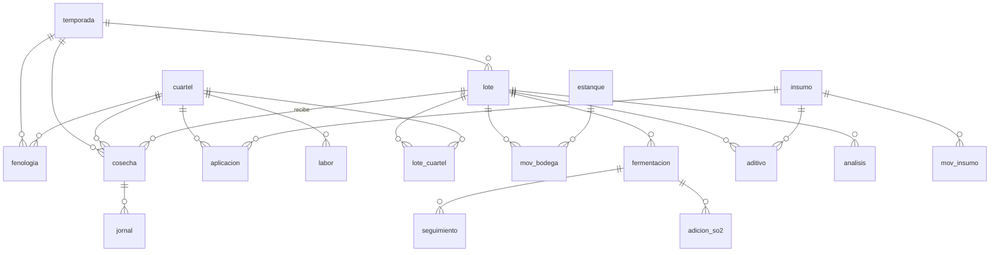
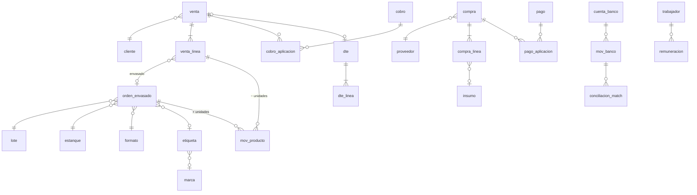

# Modelo de datos objetivo

Esquema **completo** de v2, dividido por contexto ([dominio.md](dominio.md)). Cada PR de módulo implementa en
`packages/db/src/schema.ts`, en su propio bloque, **solo las tablas que su issue nombra**
([hoja-de-ruta.md](hoja-de-ruta.md)). Así dos personas no crean la misma tabla de dos formas distintas.

Este documento es el plano. Lo que ya existe en `schema.ts` manda sobre lo de aquí; si algo cambia al implementarlo,
se actualiza este archivo en el mismo PR.

## Convenciones

| Regla | Detalle |
|---|---|
| Columnas comunes | `...base()`: `id` (texto, UUID del cliente), `org_id`, `version`, `created_*`, `updated_*`, `deleted_at`, `demo`. RLS automático ([adr/0006](adr/0006-rls-automatica.md)) |
| Offline | Las tablas marcadas **S** llevan además `...syncCols()` y van en `SYNC_ENTITIES` ([sync-offline.md](sync-offline.md)) |
| Montos | CLP en `bigint` (`money()`); nunca decimales |
| Cantidades | Litros, kg y ha en `numeric` (`num()`); tasas en `numeric(6,4)` (0,1900) |
| Fechas | `fecha` de negocio en `date` (texto `YYYY-MM-DD` en TS); instantes en `timestamptz` |
| Referencias | FK real con `references()`. En los libros de movimientos: `origen_tipo` + `origen_id` (sin FK) **y además** la FK específica cuando el origen es frecuente |
| Enums | `text` validado con Zod (no `pgEnum`: agregar un valor no debe requerir una migración difícil) |
| Nombres | Tabla y columna en español y en snake_case. En TS, camelCase con los mismos nombres de v1 cuando existen (facilita el importador) |
| Borrado | Lógico (`deleted_at`). Los libros de movimientos **no se borran**: se anulan con un movimiento inverso |
| Unicidad | Siempre por `org_id` y parcial `WHERE deleted_at IS NULL` |

Leyenda de las tablas: **S** = sincronizable (offline); **G** = global, sin `org_id` ni RLS; **L** = libro de
movimientos (solo agregar); **D** = documento con estado.

## 1. Núcleo

| Tabla | Tipo | Columnas clave | Notas |
|---|---|---|---|
| `organization` · `member` · `invitation` · `org_role` · `audit_log` | — | (existen) | [seguridad.md](seguridad.md) |
| `temporada` | S | `anio` int, `inicio` date, `fin` date, `estado` (abierta/cerrada) | Única por (org, anio), sin fechas cruzadas. La temporada 2026 = 2025-07-01 a 2026-06-30 por defecto. La actual se deriva de la fecha (no se guarda). Cerrada = solo lectura. La reciben offline todos los roles |
| `parametro_org` | — | `clave` text, `valor` jsonb, `vigente_desde` date | Tasas (IVA, ILA, PPM, IDPC), régimen, umbrales de enología (rangos de SO₂, kg/cajón, Tbase, días de desviación), rendimientos esperados, rangos de laboratorio. Única por (org, clave, vigente_desde). Online: los umbrales se aplican en el servidor (servicios y jobs). Catálogo y tipos en `PARAMETROS` (`packages/domain/src/parametros.ts`); `configVigente(tx, fecha)` arma la `OrgConfig` de esa fecha. `organization.settings` queda para preferencias de interfaz |
| `indicador` | G | `clave` (uf/utm/imm/retencion_honorarios; luego tope_imponible_uf/tope_afc_uf), `fecha` date, `valor` numeric, `fuente` | PK (clave, fecha). Histórico. Solo lectura para la app (`GLOBAL_READONLY_TABLES`); lo cargan el seed y el job con la conexión de administración. Los tramos del impuesto único siguen en código (en UTM, estables) |
| `secuencia` | — | `clave` text (`venta`, `orden_envasado:2026`, `dte:33`…), `siguiente` bigint | PK (org, clave). `siguienteNumero` / `siguienteCodigo(tx, clave, prefijo)` con un upsert que bloquea la fila hasta el fin de la transacción: sin repetidos ni huecos. El prefijo lo pone quien llama. `ajustarSecuencia` para el importador y los CAF |
| `adjunto` | — | `entidad`, `registro_id`, `clave_objeto` (R2: `org_id/…`), `nombre`, `mime`, `bytes` (quien sube = `created_by`) | [adr/0013](adr/0013-adjuntos.md). Índice (org, entidad, registro_id). Qué entidades aceptan adjuntos y su módulo: `ADJUNTABLES` (`packages/domain/src/entities/adjunto.ts`) |
| `alerta` | — | `regla`, `severidad` (info/warn/bad), `modulo`, `entidad`, `registro_id` ('' = toda la viña), `titulo`, `mensaje`, `ruta`, `estado` (abierta/resuelta), `detectada_en`, `actualizada_en`, `resuelta_en` | La escribe el motor (`packages/db/src/alertas/`, [adr/0012](adr/0012-jobs-y-alertas.md)). Única abierta por (org, regla, registro_id). Silenciar queda para después |
| `alerta_vista` | — | `alerta_id`, `user_id`, `vista_en` | Sin RLS por usuario; filtra por org |
| `tarea` | S | `titulo`, `descripcion`, `fecha`, `rol` o `user_id`, `estado` (pendiente/hecha), `ruta`, `modulo`, `origen_tipo`/`origen_id` | La crean las reacciones (p. ej. trasiego al terminar la FA). Se crea en F2-3, con la primera reacción que la usa |
| `plan` | G | `id` (piloto/esencial/completo), `nombre`, `modulos` jsonb (null = todos), `max_usuarios`, `max_gb`, `precio_clp` (null = por definir) | [adr/0014](adr/0014-planes-y-cobro.md). Fuente: `PLANES` en `packages/domain/src/planes.ts`; `npm run db:migrate` la refleja. Solo lectura para la app |
| `suscripcion` | — | PK `org_id`, `plan_id`, `estado` (prueba/activa/morosa/cancelada), `periodo_inicio`, `periodo_fin`, `proveedor` (manual), `id_externo` | Una por viña. `actorFor` la lee y calcula `actor.acceso` (`accesoDe`). La crea `createOrganization` (prueba de 30 días) y la cambia `npm run plan`. Reemplaza a `organization.plan` (columna en desuso) |
| `evento_cobro` | — | `proveedor`, `tipo`, `payload` jsonb, `procesado_en` | Webhooks del proveedor de cobro, procesados por un job (idempotente por id externo) |

## 2. Viñedo (offline)

| Tabla | Tipo | Columnas clave | Notas |
|---|---|---|---|
| `cuartel` | S | (existe) | Agregar `superficie` como numeric (ya está), `rendimiento_esperado` kg/ha opcional |
| `variedad` | S | (existe) `nombre`, `tipo` | El formulario de cuartel debe leer de aquí (v1 usaba una lista fija) |
| `fenologia` | S | `cuartel_id`, `temporada_id`, `desborre_inicio`, `desborre_50`, `desborre_fin`, `bbch`, `floracion`, `envero`, `observaciones` | Única por (cuartel, temporada) |
| `clima` | S | `fecha`, `temporada_id`, `tmax`, `tmin`, `estacion` | Única por (fecha, estación) |
| `aplicacion` | S | `fecha`, `temporada_id`, `cuartel_id`, `insumo_id`, `dosis_ha`, `cantidad`, `carencia_dias`, `costo`, `responsable` | Reacción: `mov_insumo` −cantidad |
| `labor` | S | `fecha`, `temporada_id`, `cuartel_id`, `tipo`, `jornadas`, `valor_jornada`, `otros_costos`, `costo`, `responsable` | |
| `cosecha` | S | `fecha`, `temporada_id`, `cuartel_id`, `lote_id`, `cajones`, `kg`, `destino` (propia/venta/descarte), `costo_bins`, `costo_transporte`, `costo_alimentacion`, `otros_costos` | Reacción: lote → En vendimia |
| `jornal` | S | `cosecha_id` (FK, en cascada), `nombre`, `rut`, `cuadrilla`, `trabajadores`, `horas`, `tarifa_tipo` (kg/cajon/dia), `tarifa`, `kg`, `cajones`, `jornadas`, `pago` | |

## 3. Bodega (offline)

| Tabla | Tipo | Columnas clave | Notas |
|---|---|---|---|
| `lote` | S | `codigo`, `temporada_id`, `variedad`, `tipo`, `valle`, `estado`, `litros_estimados`, `costo_uva_comprada`, `fecha_vendimia_plan`, `dias_vendimia/fa/maceracion/fml/guarda`, `fecha_molienda_real`, `inicio_fa_real`, `fin_fa_real`, `inicio_vendimia_real` | Único por (org, codigo) |
| `lote_cuartel` | S | `lote_id`, `cuartel_id`, `pct` opcional | Reemplaza `lote.cuartelIds` (N:M) |
| `ventana` | S | `variedad`, `valle`, `desde_mmdd`, `hasta_mmdd`, `fuente` | Seed de 30 ventanas al crear la viña |
| `estanque` | S | `codigo`, `capacidad_l`, `material`, `tipo`, `ubicacion`, `estado` (operativo/mantencion/reservado), `costo_mantencion` | |
| `mov_bodega` | S·L | `fecha`, `estanque_id`, `lote_id`, `litros` (con signo), `tipo` (entrada/trasiego_salida/trasiego_entrada/merma/vinagre/envasado/venta_granel/ajuste), `origen` (uva/mosto/vino), `kg_uva`, `grupo`, `motivo`, `origen_tipo`, `origen_id`, `orden_envasado_id`, `venta_id` | Índices (estanque), (lote). La entrada no-vino tiene una reacción |
| `fermentacion` | S·D | `codigo`, `lote_id`, `estanque_id`, `tipo`, `volumen`, `brix_inicial`, `ph_inicial`, `acidez_inicial`, `levadura_insumo_id`, `nutrientes`, `temperatura_objetivo`, `dias_planificados`, hitos (`fecha_molienda`, `inicio_fa`, `inicio_tumultuosa`, `fecha_corte`, `fin_fa`, `inicio/fin_maceracion`, `inicio/fin_fml`), `alcohol_final`, `azucar_residual`, `estado` (borrador/activa/cerrada) | Reacciones al iniciar y al terminar la FA |
| `seguimiento` | S | `fermentacion_id`, `fecha`, `densidad`, `brix`, `temperatura`, `ph`, `acidez_volatil`, `so2_libre`, `so2_total`, `responsable` | |
| `adicion_so2` | S | `fermentacion_id`, `fecha`, `insumo_id`, `fraccion`, `gramos`, `volumen`, `dosis_mgl`, `so2_previo`, `so2_medido`, `so2_teorico`, `costo`, `modo`, `motivo` | Reacción: `mov_insumo` (convertido a la unidad del insumo) |
| `aditivo` | S | `fecha`, `lote_id`, `estanque_id`, `tipo`, `insumo_id`, `volumen`, `modo`, `momento`, `objetivo_mgl`, `gramos`, `dosis_ghl`, `cantidad`, `costo`, `dosis_mgl` | Reacción: `mov_insumo` |
| `analisis` | S | `fecha`, `lote_id`, `laboratorio`, `autorizado_sag`, `ph`, `acidez_total`, `acidez_volatil`, `so2_libre`, `so2_total`, `alcohol`, `azucar_residual`, `turbidez`, `densidad`, `color`, `certificado_do` | Adjunto: informe en PDF |

## 4. Inventario

| Tabla | Tipo | Columnas clave | Notas |
|---|---|---|---|
| `insumo` | S | `nombre`, `categoria` (agricola/enologico/envasado/etiquetado), `tipo`, `unidad` (kg/g/L/mL/un/caja/rollo), `npk`, `precio`, `proveedor_id` (FK en F3-1), `stock_minimo`, `stock_inicial`, `vencimiento`, `carencia` (días), `quimico`, `so2_pct`, `plazo_entrega`, `condiciones` | `soloLectura`: se sincroniza para leer offline; se escribe en línea (`services/insumos.ts`). Único por nombre |
| `insumo_precio` | — | `insumo_id`, `fecha`, `precio`, `proveedor_id`, `origen` (manual/compra), `compra_id` | Reemplaza `historialPrecios` (JSON). Incluye el precio inicial |
| `mov_insumo` | S·L | `fecha`, `insumo_id`, `cantidad` (con signo, en la unidad del insumo), `tipo` (compra/aplicacion/aditivo/so2/consumo_envasado/ajuste/nota_credito), `costo_unitario`, `motivo`, `origen_tipo`, `origen_id` | `soloLectura`: lo escriben servicios (ajustes) y reacciones (aplicación). Stock en `v_stock_insumo` |
| `formato` | — | `nombre`, `litros`, `envase`, `unidades_caja`, `stock_minimo` | Seed de 4 formatos |
| `mov_producto` | L | `fecha`, `orden_envasado_id`, `formato_id`, `lote_id`, `unidades` (con signo), `tipo` (envasado/venta/anulacion/ajuste/muestra/quiebre), `costo_unitario`, `venta_linea_id`, `motivo` | **Nuevo**: stock de botellas por orden (v1 lo derivaba de las ventas) |

## 5. Comercial

| Tabla | Tipo | Columnas clave | Notas |
|---|---|---|---|
| `cliente` | — | (existe) | |
| `orden_envasado` | D | `codigo` (secuencia OE-AAAA-NNNN), `fecha`, `estanque_id`, `lote_id`, `formato_id`, `unidades`, `merma_pct`, `responsable`, insumos (`envase_id`, `cierre_id`, `capsula_id`, `caja_id`, `etiqueta_insumo_id`), `etiqueta_id`, `mano_obra`, `energia_agua`, `graduacion`, `declara_do`, `pct_uva_zona`, `certificado_do`, `estado` (borrador/confirmada/anulada), congelados: `costo_unitario`, `costo_total`, `litros_consumidos`, `costo_partes` jsonb, `confirmada_en` | Servicio `confirmarEnvasado` |
| `marca` | — | `nombre`, `titular`, `numero_inapi`, `clases`, `fecha_registro`, `vencimiento`, `costo` | Adjunto: certificado INAPI |
| `etiqueta` | — | `nombre`, `version`, `marca_id`, `disenador`, `aprobacion_legal`, costos únicos (diseño, fotografía, ilustración), `tiraje_estimado`, `costo_impresion`, `proveedor_id`, `tiraje_minimo`, declaraciones (varietal, graduación, D.O., denominación, contenido) | Adjunto: archivos de diseño |
| `venta` | D | `codigo` (secuencia V-NNNN), `fecha`, `cliente_id`, `canal`, `documento` (factura/boleta/guia), `generar_dte`, `vencimiento`, `estado` (borrador/confirmada/anulada), totales: `neto`, `exento`, `iva`, `ila`, `total`, `dte_id`, `anulada_en` | Servicios confirmar y anular |
| `venta_linea` | — | `venta_id`, `tipo` (envasado/granel), `orden_envasado_id` o (`estanque_id` + `lote_id`), `formato_id`, `descripcion`, `cantidad`, `precio` (neto), `afecto_ila`, `graduacion`, `costo_unitario` (congelado), `neto`, `litros` | **Nuevo**: varias líneas por venta |
| `cobro` | — | (existe) `fecha`, `cliente_id`, `monto`, `medio` | Cambia: `venta_id` pasa a `cobro_aplicacion` (migración) |
| `cobro_aplicacion` | — | `cobro_id`, `venta_id`, `monto` | Saldo de la venta = total − Σ aplicaciones |

## 6. Abastecimiento y gastos

| Tabla | Tipo | Columnas clave | Notas |
|---|---|---|---|
| `proveedor` | — | `nombre`, `rut`, `categoria`, `contacto`, `email`, `telefono`, `condiciones`, `plazo` | RUT válido |
| `compra` | D | `fecha`, `proveedor_id`, `documento` (factura/factura_exenta/boleta/guia/nota_credito), `folio`, `referencia_compra_id` (para las NC), `vencimiento`, `estado` (registrada/anulada), totales (**siempre positivos**): `neto`, `exento`, `iva`, `total`, `dte_id` | Folio único por (proveedor, documento). Adjunto: factura en PDF |
| `compra_linea` | — | `compra_id`, `insumo_id` (opcional), `descripcion`, `cantidad`, `precio_unitario`, `exento`, `neto` | Servicio `registrarCompra` |
| `pago` | — | `fecha`, `proveedor_id`, `monto`, `medio` | |
| `pago_aplicacion` | — | `pago_id`, `compra_id` o `gasto_id`, `monto` | |
| `gasto` | — | `fecha`, `categoria`, `descripcion`, `proveedor_id`, `monto` (neto), `documento`, `folio`, `afecto_iva`, `medio_pago`, `estado` (pendiente/pagado), `tipo_costo` (fijo/variable), `area` (admin/ventas/produccion), `no_deducible`, `dte_id` | Adjunto: comprobante |
| `presupuesto` | — | `anio`, `categoria`, `monto` | Único por (anio, categoría) |
| `activo` | — | `nombre`, `valor`, `vida_util_anios`, `fecha_compra`, `fecha_baja` | |

## 7. Personas

| Tabla | Tipo | Columnas clave | Notas |
|---|---|---|---|
| `trabajador` | — | `nombre`, `rut`, `cargo`, `area`, `contrato`, `ingreso`, `termino`, `sueldo_base`, `gratificacion` (art50/fija/ninguna), `gratificacion_monto`, `bonos`, `comisiones`, `colacion`, `movilizacion`, `afp`, `tasa_afp`, `salud` (fonasa/isapre), `plan_salud`, `vacaciones_pendientes` | Sensible (auditado) |
| `remuneracion` | D | `trabajador_id`, `periodo` (YYYY-MM), `estado` (calculada/pagada), `fecha_pago`, `dias_trabajados`, `horas_extra`, `anticipos`, resultado de `liquidacion()` en columnas (`imponible`, `afp`, `salud`, `cesantia`, `impuesto_unico`, `liquido`, `costo_empresa`…), `parametros` jsonb (foto de UF/UTM/IMM/tasas) | Única por (trabajador, periodo) |
| `honorario` | D | `fecha`, `nombre`, `rut`, `numero`, `descripcion`, `bruto`, `tasa_retencion`, `retencion`, `liquido`, `estado` (pendiente/pagada) | |

## 8. Tesorería

| Tabla | Tipo | Columnas clave | Notas |
|---|---|---|---|
| `cuenta_banco` | — | `banco`, `tipo`, `numero`, `moneda`, `fecha_inicio`, `saldo_inicial` | |
| `cartola` | — | `cuenta_id`, `adjunto_id`, `mapeo_columnas` jsonb, `filas_importadas`, `importada_en` | Cada importación queda trazable |
| `mov_banco` | L | `cuenta_id`, `cartola_id`, `fecha`, `glosa`, `monto` (+ abono / − cargo), `estado` (pendiente/conciliado/diferencia), `huella` (fecha + monto + glosa, única por cuenta) | |
| `conciliacion_match` | — | `mov_banco_id`, `origen_tipo` (cobro/pago/remuneracion/gasto/pago_impuesto/honorario), `origen_id`, `monto`, `diferencia`, `nota`, `automatico` | Reemplaza `matchRef` (texto) |

## 9. Tributario y cumplimiento

| Tabla | Tipo | Columnas clave | Notas |
|---|---|---|---|
| `dte` | D | `direccion` (emitido/recibido), `tipo` (33/34/39/52/56/61), `folio`, `fecha`, `estado` (borrador/generado/enviado/aceptado/rechazado/anulado), `fechas_estado` jsonb, contraparte (`rut`, `razon_social`, `giro`, `direccion`, `comuna`), totales (`neto`, `exento`, `iva`, `ila`, `total`), `forma_pago`, `vencimiento`, `referencia` jsonb (para NC/ND), `venta_id`, `compra_id`, `gasto_id`, `xml_adjunto_id`, `proveedor_dte`, `id_externo` | Único (org, direccion, tipo, folio, rut contraparte). Ver la interfaz `ProveedorDTE` |
| `dte_linea` | — | `dte_id`, `nombre`, `cantidad`, `unidad`, `precio`, `monto`, `cod_imp_adic` | |
| `caf` | — | `tipo`, `desde`, `hasta`, `fecha_autorizacion`, `adjunto_id` (XML del CAF cuando sea real) | |
| `f29` | D | `periodo`, `estado` (borrador/revisado/declarado/pagado), `folio_sii`, `snapshot` jsonb | Único por periodo |
| `renta` | D | `anio_comercial`, `anio_tributario`, `estado`, `folio_sii`, `snapshot` jsonb | |
| `pago_impuesto` | — | `tipo` (F29/PPM/renta/patente/contribuciones), `periodo`, `fecha`, `monto`, `folio_sii`, `incluido_en_f29` | Candidato de conciliación |
| `obligacion` | — | `clave` (p. ej. `F29-2026-09`), `estado` (pendiente/cumplida), `fecha`, `folio` | El calendario se genera en código y esta tabla guarda el cumplimiento |
| `cumplimiento` | — | `nombre`, `tipo` (SAG/SII/Patente/INAPI/D.O./Certificación/Municipal/Otro), `numero`, `estado`, `fecha`, `vencimiento`, `aviso_dias`, `responsable`, `notas` | Adjunto: resolución o certificado |

**Interfaz `ProveedorDTE`** (en `packages/domain`, sin implementar todavía):
`emitir(dte, lineas) → {estado, xml, id_externo}` · `consultarEstado(id_externo)` · `anular(dte)`. La implementación
`simulado` reproduce v1. Una real (proveedor externo autorizado) se enchufa después sin tocar el modelo.

## Diagramas

## Vistas derivadas (SQL)

Los stocks y saldos **no se guardan**: se calculan con vistas, que heredan el RLS porque usan
`security_invoker = true`. Se crean desde `ensure.ts` igual que las políticas, y su test vive en
`packages/db/test/`.

| Vista | Definición |
|---|---|
| `v_stock_estanque` | Σ litros por (estanque, lote) con `deleted_at IS NULL`, filtrando > 0,5 L |
| `v_ocupacion` | `v_stock_estanque` + capacidad → % por estanque y por tipo de vino |
| `v_stock_insumo` | `stock_inicial` + Σ `mov_insumo.cantidad`, × precio vigente |
| `v_stock_producto` | Σ `mov_producto.unidades` por (orden, formato), × costo unitario congelado |
| `v_saldo_venta` | `venta.total` − Σ `cobro_aplicacion.monto` (solo confirmadas) |
| `v_saldo_compra` | `compra.total` × signo(documento) − Σ `pago_aplicacion.monto` |
| `v_balance_lote` | Entradas, envasado, granel, mermas, vinagre, ajustes y stock por lote, más kg de uva y L/kg |

Los cálculos complejos (costo por litro, estado de resultados, F29) siguen como **funciones puras** en
`packages/domain`. Reciben filas y la configuración, tienen tests de paridad con v1 y se ejecutan en el servidor.

## Mapeo v1 → v2 (las 49 entidades)

Guía para el importador (`packages/db/src/import-v1.ts`, `IMPORTERS`).

| v1 | v2 | Nota |
|---|---|---|
| config | `organization` + `parametro_org` | Empresa → organization; tributario, enología, finanzas → parametro_org; remuneraciones → `indicador` (global) |
| usuario, rol | `user` + `member`, `org_role` | No se importan los PIN; se invita por correo |
| auditoria | `audit_log` | Opcional (histórico) |
| tarea | `tarea` | |
| cuartel, variedad | `cuartel`, `variedad` | Ya importados |
| fenologia, clima, aplicacion, labor, cosecha, jornal, ventana | igual | `temporada` (número) → `temporada_id` (se crea si falta) |
| lote | `lote` + `lote_cuartel` | `cuartelIds[]` → filas |
| analisis, aditivo, fermentacion, seguimiento, adicionSO2, estanque | igual (`adicion_so2`) | |
| movBodega | `mov_bodega` | `ref` 'venta:x'/'envasado:x' → `venta_id`/`orden_envasado_id` |
| insumo | `insumo` + `insumo_precio` | `historialPrecios[]` → filas |
| movInsumo | `mov_insumo` | `ref` → `origen_tipo`/`origen_id` |
| formato, marca, etiqueta | igual | |
| ordenEnvasado | `orden_envasado` + `mov_producto` (+unidades) | |
| venta | `venta` + 1 `venta_linea` + `mov_producto` (−) | `pagado` → `cobro` + `cobro_aplicacion` si no existen |
| cliente | `cliente` | Ya importado |
| cobro | `cobro` + `cobro_aplicacion` | `ventaId` → aplicación |
| trabajador, remuneracion, honorario | igual | remuneracion: guardar `parametros` vacío (no se conocían) |
| gasto, presupuesto, activo, proveedor | igual | |
| compra | `compra` + 1 `compra_linea` | NC: pasar montos a positivo |
| pago | `pago` + `pago_aplicacion` | |
| cumplimiento, caf, f29, renta, pagoImpuesto, obligacion | igual (`pago_impuesto`) | |
| dte | `dte` + `dte_linea` | `detalle[]` → filas; `xml` → adjunto |
| cuentaBanco, movBanco | `cuenta_banco`, `mov_banco` + `conciliacion_match` | `matchRef` → match |

Sin equivalente: `meta` (preferencias locales de v1), `_v`/migraciones de v1, PIN y sesión.

## Qué cambia en lo ya implementado

- **`cobro.venta_id`**: pasa a `cobro_aplicacion`. Migración generada + ajuste en `clientes/actions.ts` y en el
  importador. Va en el issue de ventas (F5).
- **`organization.settings`**: los valores de negocio pasan a `parametro_org`; `settings` queda para preferencias
  de interfaz. Va en el issue de parámetros (F0).
- **`variedad`**: el formulario de cuartel empieza a leerla. Va en el issue de maestros (F1).
